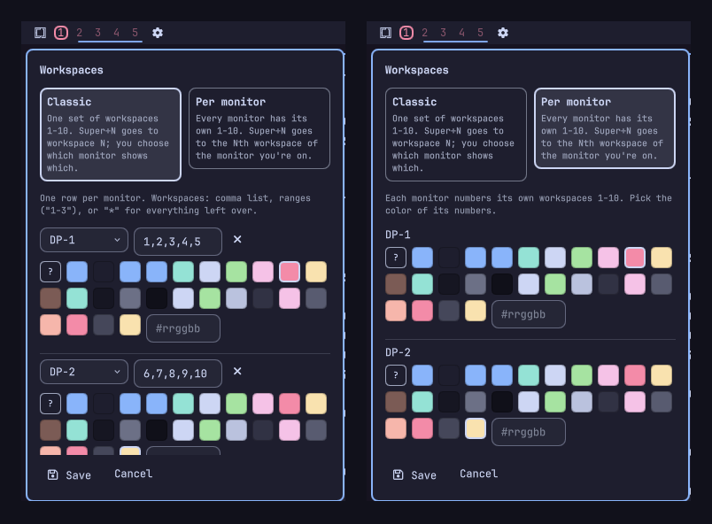

# Workspaces by Monitor

An [Omarchy](https://omarchy.org/) shell plugin. A drop-in replacement for
the stock `omarchy.workspaces` bar widget that lets you choose **how
workspaces work** (two schemes, below), colors the numbers however you like,
and draws a frame around the focused workspace.

A gear icon at the end of the widget opens a settings popup for configuring
everything below — no manual `shell.json` editing needed for day-to-day
changes.

## Two schemes

Pick one in the gear popup. Switching is one click plus **Save**, and the
plugin reconfigures Hyprland to match — key bindings included.

| | **Classic** | **Per monitor** |
|---|---|---|
| Workspaces | One global set, 1-10 | Every monitor has its own 1-10 |
| `Super+N` | Workspace N | The Nth workspace of the monitor you're on |
| `Super+Shift+N` | Move the window to workspace N | Move it to the Nth workspace of this monitor |
| Which monitor shows what | You decide (pins, e.g. 1-5 left, 6-10 right) | Automatic — Omarchy's own model |
| Under the hood | Plain Hyprland workspaces | Omarchy 3.4's per-monitor blocks (monitor 1 = 1-10, monitor 2 = 11-20, ...), bar labelled 1-10 |

**Classic** is how Hyprland and this plugin always worked. Omarchy's
per-monitor numbering is switched off (its workspace manager no longer
renumbers anything), `Super+N`, `Super+Shift+N`, `Super+Shift+Alt+N` and
the move-workspace-to-monitor binds are plain Hyprland again, and any
workspace left on a block number (11+) is folded back onto one of the
monitor's pinned numbers on reload.

**Per monitor** hands everything back to Omarchy. The plugin leaves no pins
or overrides in your Hyprland config, and the settings popup shows nothing
from the classic scheme — just a color per monitor. (Your classic groups
stay saved in `shell.json`, so switching back restores them.)



## Using the settings popup

Click the gear icon next to the workspace numbers. At the top, two cards
choose the scheme. Below them:

**Classic** — one row per monitor:

- **Monitor** — a dropdown of currently connected outputs (plus whatever
  monitor a row is already set to, even if it's not connected right now).
- **Workspaces** — which workspace numbers belong to that monitor. Accepts
  a comma list (`1,2,3`), a range (`1-5`), a mix (`1-3,7`), or `*` meaning
  "every workspace 1-10 not claimed by another row".
- **Color** — see below.

**Add monitor** appends a row. If the same workspace number is assigned more
than once (`1,2,2`, or split across two monitors), the affected field gets a
red outline, a message names the numbers, and Save is disabled until it's
fixed. A row whose monitor isn't currently connected gets a warning mark,
which doesn't block Save (it's often just an unplugged external monitor).

**Per monitor** — one row per connected monitor with just its number color.
No workspace assignments: Omarchy decides which monitor owns what.

### Colors

Every color choice is a row of swatches, one per key the active theme's
`colors.toml` defines (so they follow theme switches), the `?` swatch for an
automatic color from a built-in rotation, and a `#rrggbb` field for any color
of your own.

- **Number color** — per monitor (per group in Classic).
- **Focus frame** — the frame around the focused workspace. Default is "same
  as the number"; pick a color to use one frame color everywhere.

**Save** writes the settings to this widget's `shell.json` entry, rewrites
the plugin's block in `~/.config/hypr/monitors.lua` (below) and reloads
Hyprland. **Cancel**, the gear icon, or clicking outside close the popup
without saving.

### What Save changes in Hyprland

Everything lives between two marker comments in `~/.config/hypr/monitors.lua`
(Save appends them at the end of the file if they aren't there):

```lua
-- air.workspaces: BEGIN auto-generated workspace pins
...
-- air.workspaces: END auto-generated workspace pins
```

- **Classic:** `hl.workspace_rule()` pins for your groups, the plain
  Super+N bindings, Omarchy's renumbering switched off, and the 11+ fold.
- **Per monitor:** just a comment — no pins, no overrides.

Anything outside the markers is left alone; hand edits inside them are
overwritten on the next Save. If you rebind Super+N yourself in
`bindings.lua`, that loads after this block and wins.

## Configuring by hand

Everything the popup writes lives on this widget's `shell.json` layout entry
(Save in the popup afterwards, or the Hyprland side won't follow):

```json
{
  "id": "air.workspaces",
  "scheme": "classic",
  "groups": [
    { "monitor": "DP-1", "ids": [1, 2, 3, 4, 5], "colorKey": "red" },
    { "monitor": "DP-2", "ids": "*", "colorKey": "#ffb347" }
  ],
  "monitorColors": { "DP-1": "red", "DP-2": "yellow" },
  "frameColor": ""
}
```

- `scheme` — `"classic"` (default) or `"per-monitor"`.
- `groups` — Classic only. `monitor` is the output name (`hyprctl monitors |
  grep Monitor`); `ids` an array or `"*"` for the leftovers; `colorKey` a
  `colors.toml` key or `#rrggbb`.
- `monitorColors` — Per monitor only; output name to `colors.toml` key or
  `#rrggbb`.
- `frameColor` — optional key or `#rrggbb` for the focus frame.

## Install on another machine

1. Copy this whole directory to `~/.config/omarchy/plugins/<username>.workspaces/`
   (Omarchy plugin ids are `<username>.<name>`; rename the `id` fields in
   `manifest.json` to match if you use a different directory name).
2. In `~/.config/omarchy/shell.json`, point the `left`/`center`/`right` bar
   layout at it (e.g. replace `omarchy.workspaces` with `<username>.workspaces`).
3. Save the shell config — it hot-reloads plugins and `shell.json`
   automatically. Use the gear icon to configure it. The first Save adds the
   plugin's block to `~/.config/hypr/monitors.lua` by itself.

Requires Omarchy 3.4+ (Lua Hyprland config, `o.rebind`, `o.workspaces`).
